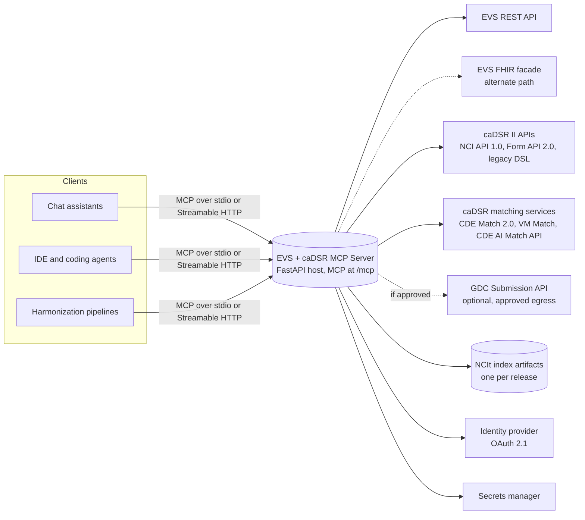
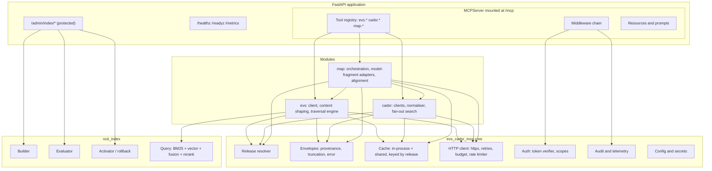
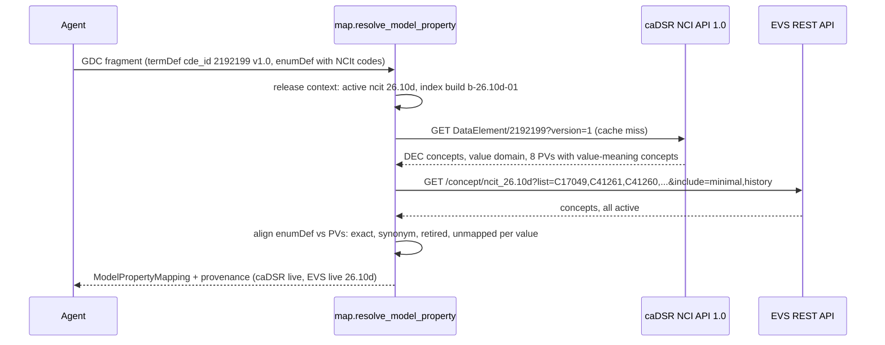

# Project Proposal: EVS + caDSR MCP Server

**Working name:** `evs-cadsr-mcp` (Python package `evs_cadsr_mcp`)
**Version:** 1.0 (proposal)
**Date:** 2026-10-29
**Status:** Standalone proposal for a new implementation. It builds on the v1 EVS design (`design-docs-and-req/evs-mcp-design.md`) and adds the v1 caDSR design (`design-docs-and-req/cadsr-mcp-design.md`) and a cross-domain mapping layer. It does not depend on, extend, or borrow from any existing MCP implementation.
**Governing requirements:** "Reconciled SOW v2, NCI Semantic Infrastructure MCP EVS Capability" (2026-08-17), cited as SOW-S1..S16 (scope paragraphs), SOW-T1..T8 (the eight minimum EVS tool capabilities), SOW-D1..D9 (deliverables). The SOW permits a de novo build when no suitable baseline is adopted; this proposal is written for that path.

> Upstream facts (EVS REST API, caDSR II APIs, GDC dictionary, MCP specification and Python SDK) were verified on 2026-10-29. Items that still need confirmation are marked **[confirm at architecture review]**.

---

## 1. Executive summary

NCI's terminology (EVS, the NCI Thesaurus) and metadata (caDSR, Common Data Elements) are served by two unrelated REST surfaces that LLM agents cannot use well directly: EVS has a large, parameter-rich API with release semantics the caller must manage, and caDSR II exposes deeply nested ISO/IEC 11179 structures through several small webMethods services with no search or paging. This proposal describes one **Model Context Protocol (MCP) server**, hosted in a FastAPI application, that gives agents a small, typed, release-grounded, provenance-carrying tool set over both systems and over the joins between them.

The server is delivered in three increments that each stand on their own:

1. **EVS module** (`evs.*`): concept lookup and search, a release-pinned local NCIt retrieval index for semantic and hybrid search, bounded traversal of hierarchy, roles and associations, subsets, maps, and history. This satisfies SOW-T1..T8 and the platform requirements of SOW-S9..S16.
2. **caDSR module** (`cadsr.*`): CDE retrieval by identity, derived value-domain and permissible-value views, native reverse lookup from NCIt concept to CDEs, declared fan-out search, forms, and the caDSR matching services.
3. **Mapping module** (`map.*`): the primary use case, mapping between CDE content and NCIt concepts, starting with the Genomic Data Commons (GDC) data dictionary and extending to other Cancer Research Data Commons (CRDC) models.

Design stance carried over from the v1 EVS design: a **thin, stateless, cache-forward, read-only** translation layer that never writes to upstream systems, never invents content, pages everything, bounds every traversal, and cites every item.

---

## 2. Background and scope

### 2.1 Upstream systems (verified 2026-10-29)

**EVS REST API**, base `https://api-evsrest.nci.nih.gov/api/v1` (OpenAPI at `/v3/api-docs`, version 2.5.0.RELEASE). Public, unauthenticated, no documented rate limit. NCIt is CC BY 4.0. Facts that drive the design:

- Release naming is `YY.MM<letter>` (for example `26.10d`). Bare `ncit` resolves to the latest monthly release. A specific release is addressed by the `terminologyVersion` string in the path (`/concept/ncit_26.09d/C3224`). **Only the three most recent NCIt releases are served live**; older ones return 404.
- `include` selects content: `minimal`, `summary` (synonyms, definitions, properties), `full` (everything except descendants and paths), or itemised flags (`children`, `parents`, `roles`, `inverseRoles`, `associations`, `inverseAssociations`, `maps`, `history`, `paths`, `descendants`, `disjointWith`, `subsetLink`).
- Limits: search `pageSize` ≤ 1000; batch `GET /concept/{t}?list=` ≤ 1000 codes (URL length caps the practical batch near 600); SPARQL ≤ 1000 rows per page with a 60 s server timeout.
- `search?property=<name>&value=<v>` filters by property value but **not** by role. Role or association targets are reached through `/{code}/inverseRoles`, `/{code}/inverseAssociations`, the terminology-wide `/concept/ncit/associations/{label}` (paged, excludes subset associations), or SPARQL (`POST /concept/ncit/search` with a query selecting `?code`, or `POST /sparql/ncit`).
- There is no `/ancestors` endpoint (use `pathsToRoot`); `/descendants` is flat with `level` and `maxLevel`; `/subtree` returns tree nodes; history and replacements come from `include=history` and `/history/{t}/{code}/replacements` (batch form available).
- Licensing: header `X-EVSRESTAPI-License-Key`; only MedDRA is hard-gated (403 without a key); SNOMED CT US, NCIm and ICD-10 carry display obligations (`licenseText`) but no key check; AJCC is not loaded.
- Mapping-relevant content: property P334 `ICD-O-3_Code`; associations A8 `Concept_In_Subset`, A12 `Has_Data_Element`, A31 and A32 (GDC value links); mapsets including `NCIt_Maps_To_GDC` and `NCIt_Maps_To_ICD10CM`; the CDISC subset tree under C61410. A FHIR R4/R5 facade (`/fhir/r4`) offers `ValueSet/$expand` and `ConceptMap/$translate` as an alternate path.

**caDSR II APIs**, host `https://cadsrapi.cancer.gov`. There is no single "caDSR API v2"; the data-element API is **NCI API 1.0** and the Form API and CDE Match are version 2.0:

| API | Base | Auth | Capabilities |
|---|---|---|---|
| NCI API 1.0 | `/rad/NCIAPI/1.0/api` (Swagger 2.0 via `/invoke/pub.swagger:getSwaggerJsonDoc?radName=NCIAPI.v1_0:NciApiRad`) | none | `DataElement/{publicId}?version=` (fully expanded CDE), `DataElements?publicId=` (versions), `DataElements/Context`, `DataElements/Concept?conceptCode=&itemTypeFilter=&workflowStatusFilter=&headerOnly=` (CDEs annotated with a concept), `DataElements/Classification`, `DataElements/AlternateName`, `DataElements/ReferenceDocument` (question text), `DataElements/getCRDCList` |
| Form API 2.0 | `/rad/NCIFormAPI.v2_0:NciFormApiRad` | none | `Form/{publicId}?version=`, `Form/query` |
| Legacy query DSL | `/rad/caDSR.restapi:GetJSON_rad/GetJSON?query=` | none on this path | object-graph queries such as `Question&DataElement[@publicId=…,@version=…]` (the only route for "forms that use a CDE") |
| LOV API 1.0 | `/rad/NCILovAPI/1.0/api` | Basic | contexts, workflow and registration status lists |
| CDE Match 2.0 | `/rad/NCIAPI.v2_0.cdeMatch.api:cdeMatch_rad/cdeMatch` (POST) | Basic | rule-based matching of headings and values to CDEs |
| VM Match | `/rad/vmMatch/v1/vmMatch` (POST) | none | value string to value meaning |
| CDE AI Match API | per environment (caDSR-operated, private repository) | none enforced in code | embedding-based CDE candidate retrieval with permissible-value alignment; `POST /match`, `GET /embedding_variants` |

Behaviour: no keyword search and no pagination in NCI API 1.0; no value-domain, DEC, value-meaning, or PV-by-id endpoints; errors arrive as **HTTP 200 with `apiResponse.type = "E"`**; a CDE takes 6 to 10 s and 100 to 400 KB; `Accept: application/json` is required; credentials for Basic-auth services are issued per environment by the caDSR team. NCIt codes appear as `Concepts[] {longName, conceptCode, definition, evsSource, primaryIndicator, displayOrder}` on the object class, property, representation term, and each permissible value's value meaning; `evsSource` is `NCI_CONCEPT_CODE` for NCIt and may also be `CTCAE_CODE`, `RADLEX_CODE`, `NCI_META_CUI`, `UMLS_CUI`, or `LOINC_CODE`.

**GDC data dictionary** (`NCI-GDC/gdcdictionary`, schemas under `src/gdcdictionary/schemas/`): `_terms.yaml` maps each property to a caDSR CDE (`termDef.source: caDSR`, `cde_id`, `cde_version`); `_terms_enum.yaml` maps each enumerated value to an NCIt code and release; entity schemas wire values through `enumDef`. The **GDC Submission API** (`GET https://api.gdc.cancer.gov/v0/submission/_dictionary/_all` or `/{entity}`) returns the dictionary with references resolved. The `gender` property was removed in dictionary v4.0.3 (2026-05-28) in favour of `sex_at_birth` (caDSR 7572817 v3.0). Other CRDC models in Bento Model Description Format (CDS, ICDC, CTDC, CCDI, CDA) carry `Term: [{Origin: caDSR, Code, Version, Value}]` at property level only.

### 2.2 In scope

- One MCP server, one codebase, three tool namespaces, three deployment profiles (`evs-only`, `cadsr-only`, `unified`).
- Read-only access with release pinning, pagination, budgets, provenance, audit, and authentication for remote use.
- A release-pinned local NCIt retrieval index (BM25, vector, hybrid) with an evaluation protocol and atomic activation and rollback.
- Cross-domain mapping tools for CDE to NCIt and NCIt to CDE, GDC and MDF model fragments, value-set alignment, release impact, and ICD-O to NCIt.
- Test suite, benchmark method, deployment guidance, user and developer documentation.

### 2.3 Out of scope (mirrors the SOW)

Any GUI; hosted vector-database infrastructure (the index is a file artifact); training or fine-tuning embedding models; NCIm-wide vectorization or traversal; terminology or CDE content editing; changes to EVS or caDSR APIs (requested through an upstream register instead); license procurement; operations after the period of performance.

---

## 3. Goals and non-goals

**Goals**

1. Expose EVS and caDSR as small, typed, well-described MCP tools with structured output, so agents select and chain them correctly without custom glue.
2. Make every NCIt answer release-grounded and every item citation-ready (source URI, terminology, release, code, retrieval time, live or cache or index origin).
3. Keep responses inside an agent's context budget: default `summary` detail, mandatory pagination, bounded traversal with explicit truncation.
4. Be a good citizen toward shared federal APIs: cache aggressively, limit concurrency and rate, retry with backoff, never fan out when a batch endpoint exists.
5. Provide the CDE to NCIt mapping capability that neither upstream offers on its own, with evidence and without fabrication.
6. Deploy as a stateless, horizontally scalable service on AWS, or locally over stdio, from the same code.

**Non-goals**

- No write path to EVS or caDSR. No synthesis of terminology or metadata content. No clinical decision support. No handling of patient data.
- No server-side LLM calls by default. Natural-language interpretation belongs to the client LLM; the server contributes exact and semantic retrieval, prompts, and structured results. LLM-dependent retrieval enhancers are an optional, NCI-approved, audited add-on.

---

## 4. Users and use cases

### 4.1 Actors

| Actor | Client | Needs |
|---|---|---|
| CRDC data modeler (GDC, CDS, ICDC, CTDC, CCDI) | IDE agent, chat assistant | CDE and NCIt identifiers for properties and values; model linting; crosswalks |
| caDSR curator | chat assistant, curation tooling | release impact on CDEs; candidate concepts for new CDEs; duplicate detection |
| EVS terminologist | chat assistant | lookup, hierarchy, roles, subsets, maps with provenance |
| Study data manager | harmonization pipeline | map local columns and values to CDEs and NCIt |
| Application developer | custom agent | stable, versioned tools with structured output |
| Operator | admin REST, CLI | build, evaluate, activate, roll back index releases; monitor |

### 4.2 Primary use case: CDE to NCIt mapping, starting with GDC

- **UC-1 Ground a GDC property.** Input: a GDC property fragment (or `entity, property` against a pinned dictionary release if server-side fetch is approved). Read `termDef.cde_id` and `cde_version`, fetch the CDE from caDSR, extract object-class, property, representation-term and value-meaning concepts, resolve each against EVS at the pinned NCIt release (name, status, replacement if retired). Output: `ModelPropertyMapping` with per-source provenance.
- **UC-2 Property without a CDE.** Find concept candidates for the property name and description, then CDEs annotated with those concepts, ranked with an evidence chain. Never fabricate a CDE.
- **UC-3 Enum alignment.** Compare a GDC `enumDef`, an MDF enum, or a plain value list against a CDE's permissible values and optionally an NCIt subset; per value: `exact`, `synonym`, `retired`, `unmapped`, `ambiguous`.
- **UC-4 Concept impact.** "Which CDEs use C12345?" with optional bounded descendant expansion.
- **UC-5 Release-change remediation.** After a monthly NCIt release, list CDEs whose annotation concepts were retired or merged, with replacements.
- **UC-6 Cross-model crosswalk.** Do two properties in two models share a CDE, share concepts, or neither?
- **UC-7 New-CDE curation assist.** Assemble a labelled proposal (object class, property, representation term, candidate value meanings) from NCIt and analogous CDEs; nothing is written.
- **UC-8 Submission lint.** Check a model fragment for stale CDE versions, invalid NCIt codes at the pinned release, and enum/PV mismatches.
- **UC-9 ICD-O to NCIt.** Map an ICD-O-3 morphology or topography code or term to NCIt via the `ICD-O-3_Code` property and the EVS ICD-O crosswalk, with optional roll-up to the ICD-O diagnosis group.

### 4.3 Secondary use case: natural-language queries

- **UC-10 Definition and allowed values.** "What is `tumor_grade` in GDC and which values are allowed?" A prompt chains UC-1 with permissible values and returns a citation block.
- **UC-11 Term resolution.** Exact lookup, then upstream search, then semantic search, then paths to root.
- **UC-12 Cohort term expansion.** Descendants of a disease concept with exclusion roles preserved but not expanded by default.

### 4.4 Tertiary use case: data-model building

- **UC-13 Property authoring** (suggest CDEs and NCIt codes for a draft MDF property), **UC-14 value-set authoring** (coverage against a CDE value domain or NCIt subset), **UC-15 model coverage report**.

### 4.5 Further use cases enabled by the joint server

CDISC/SDTM codelist alignment against NCIt subsets; CRF annotation review; semantic de-duplication of CDEs by shared concepts; cross-terminology mapping of CDE values through EVS mapsets; retired-concept remediation in local dictionaries; provenance-grounded chatbot answers; harmonization of legacy data dictionaries through CDE Match, VM Match and the CDE AI Match API; gene and biomarker element grounding through NCIt roles; study-level disease coding for INS and CCDI.

---

## 5. Architecture overview

### 5.1 Principles

Read-only and source-faithful (refuse with `capability_unavailable` rather than work around; declared exceptions are labelled); release-grounded (resolver before any EVS call, release in every cache key, cursor, and index artifact, consistency tested); bounded (pagination, budgets that include retries, truncation as a result field); citation-ready; one codebase with profiles; transport-independent handlers; stateless by construction; secure by default; evidence over assertion (contract fixtures and live smoke tests back every upstream claim).

### 5.2 Context



### 5.3 Components



| Component | Responsibility |
|---|---|
| FastAPI host | ASGI lifespan; mounts the MCP app; serves health, readiness (reports active release and index build), metrics, protected index administration, and REST OpenAPI docs |
| MCPServer (official `mcp` v2) | tools, resources, prompts registered per profile; serves current (2026-07-28) and legacy (2025) protocol clients from one endpoint |
| Middleware chain | correlation id, OpenTelemetry, authentication binding, scope check, rate limit, audit, release context, cache hints |
| `core` | everything shared: envelopes, release resolver, cache, resilient HTTP client with outbound budget, auth, audit, config |
| `evs` module | EVS client, compact record shaping, `include` policy, traversal engine, concept-set planner, license gate |
| `cadsr` module | NCI API 1.0, Form API 2.0, legacy DSL, LOV, CDE Match, VM Match, CDE AI Match clients; ISO 11179 normaliser; derived views; fan-out search |
| `map` module | cross-domain orchestration over the `evs` and `cadsr` modules through internal capability interfaces; model-fragment adapters (GDC JSON and YAML, MDF YAML); alignment, lint, impact, crosswalk, ICD-O |
| `ncit_index` | standalone package (no MCP imports): build, evaluate, activate, roll back, query |

### 5.4 Package layout

```
src/evs_cadsr_mcp/
  core/        config.py, secrets.py, envelopes.py, errors.py, release.py, cache.py,
               http_client.py, budget.py, ratelimit.py, auth.py, audit.py, telemetry.py,
               cursor.py, registry.py, profiles.py
  evs/         client.py, fhir.py, models.py, content.py, traversal.py, polarity.py,
               find_concepts.py, maps.py, tools.py
  cadsr/       client.py, normalise.py, search.py, matching.py, models.py, tools.py
  map/         capability.py, resolve.py, align.py, fragments/{gdc_json,gdc_yaml,mdf_yaml}.py,
               lint.py, impact.py, icdo.py, tools.py
  server/      app.py (FastAPI + Mount), mcp_app.py, admin.py, health.py, cli.py
src/ncit_index/  storage.py, build.py, embeddings.py, scoring.py, rerank.py, enhancers.py,
                 evaluate.py, manifest.py
spec/            tools/*.schema.json, envelopes/*.schema.json, interface-baseline/<version>/
tests/           unit/, contract/ (recorded fixtures), integration/, live/, retrieval/, perf/
```

### 5.5 Hosting the MCP server in FastAPI (illustrative)

```python
from contextlib import asynccontextmanager
from fastapi import FastAPI
from mcp.server import MCPServer
from mcp.server.transport_security import TransportSecuritySettings

from evs_cadsr_mcp.server.mcp_app import build_mcp_server
from evs_cadsr_mcp.server.admin import admin_router
from evs_cadsr_mcp.server.health import health_router

mcp: MCPServer = build_mcp_server(profile=settings.profile)   # registers evs.*, cadsr.*, map.* per profile

mcp_asgi = mcp.streamable_http_app(
    transport_security=TransportSecuritySettings(
        allowed_hosts=[settings.public_host, f"{settings.public_host}:*"],
        allowed_origins=settings.allowed_origins,
    )
)

@asynccontextmanager
async def lifespan(app: FastAPI):
    async with mcp.session_manager.run():      # a mounted sub-app's lifespan does not run on its own
        yield

app = FastAPI(title="EVS + caDSR MCP admin plane", lifespan=lifespan)
app.include_router(health_router)
app.include_router(admin_router, prefix="/admin")
app.mount("/mcp", mcp_asgi)
```

A tool is declared with a Pydantic return type, which becomes its output schema, and read-only annotations:

```python
@mcp.tool(name="evs.get_concept", title="Get NCIt concept",
          annotations=ToolAnnotations(read_only_hint=True, destructive_hint=False,
                                      idempotent_hint=True, open_world_hint=False))
async def get_concept(code: Annotated[str, Field(pattern=r"^C[1-9][0-9]*$")],
                      terminology: str = "ncit",
                      release: str | None = None,
                      include: list[str] = ["summary"]) -> Envelope[Concept]:
    """Retrieve one concept at a pinned release with provenance."""
    ctx = release_context(terminology, release)
    return await evs_content.get_concept(ctx, code, include)
```

---

## 6. Increment 1: EVS module

This increment carries the v1 EVS design forward and adds the SOW's index, traversal, release, and license requirements.

### 6.1 Release model (SOW-S11)

- A release registry polls `GET /metadata/terminologies?terminology=ncit` (default every 10 minutes) and records the latest monthly release and the releases currently live.
- `release_context(terminology, requested)`: with no request, the **active release** is used (the release that is both the latest live monthly release and the active index release; if they differ during a rollover the server stays on the index release for index-backed tools and reports a `release_window` warning). A requested release that is live but not indexed is allowed for live-only tools and refused with `release_mismatch` for index-backed tools. A requested release that EVS no longer serves returns `release_not_available` unless the tool is index-only and the index retains it.
- Only `evs.list_terminologies` and `evs.list_releases` run without a release context. Cache keys, cursors, and index artifacts embed the release; a cached item without a release is discarded; an upstream `version` that differs from the pinned release fails closed.

### 6.2 Content retrieval and `include` policy (SOW-T1, T4)

Default detail is `summary`; `full` is allowed but documented as expensive; itemised flags are passed through. Batch retrieval uses `GET /concept/{t_ver}?list=` chunked to the URL limit (about 600 codes per request), never per-code fan-out. Compact records drop redundant URIs and large qualifier blocks unless requested.

### 6.3 Search (SOW-T2)

Three tools with distinct contracts: `evs.lookup_concept` (exact code, preferred name, or synonym with optional synonym source and term type), `evs.search_concepts` (upstream Elasticsearch with EVS filters: `type` in `contains | match | startsWith | phrase | AND | OR | fuzzy`, `conceptStatus`, `property` + `value`, `synonymSource`, `synonymTermType`, `definitionSource`, `subset`), and `evs.semantic_search` over the local index (Section 6.7).

### 6.4 Traversal engine (SOW-T3, S12)

Bounded breadth-first walk over selected relationship kinds with a budget object (`maxDepth` default 2 cap 4, `maxNodes` 200 cap 1000, `maxEdges` 1000 cap 5000, `maxRequests` 50 cap 200 **including retries**, optional `perKind` caps). A fair scheduler alternates relationship kinds so one kind cannot starve the others; visited sets prevent redundant child or descendant fetches; batches of at most 50 codes (10 for inverse relations) are projected with itemised `include`. Truncation reports the first bound that dropped anything, with reached and omitted counts per kind and `exact: false` when the omitted count is a lower bound. **Exclusion polarity:** NCIt roles whose semantics are negative (the `Disease_Excludes_*` family, configured by role code at deployment) are kept as edges with `polarity: negative` and full provenance but are not expanded unless the caller asks. Per-hop provenance carries depth, relationship kind, name and code, direction, polarity, release, source URI, qualifiers (present or explicitly `null`) and the evidence field.

### 6.5 Concept sets by criteria (SOW-T5)

`evs.find_concepts` is a planner: property-valued criteria go to `search?property=&value=`; role or association targets go to `/{target}/inverseRoles` or `/inverseAssociations`; a whole association type goes to `/concept/ncit/associations/{label}`; combinations go to SPARQL through `POST /concept/ncit/search` with a `?code`-selecting query. The result names the path taken. SPARQL use is recorded in the fallback register for NCI approval.

### 6.6 Subsets, maps, history (SOW-T6, T7, T8)

Subset members come from `GET /subset/{t_ver}/{code}/members` (paged), with FHIR `ValueSet/$expand` as an alternate path. `evs.get_subtree` accepts attribute criteria (property values, concept status) and a depth cap. Maps come from `include=maps` and the mapset endpoints. **License gate:** for a mapset whose target terminology is key-gated and for which no authorised key is configured, the result carries the mapset identity and assertion count only, plus a `licenseRequired` marker; with an authorised key the full assertions are returned and the provenance records the basis. Whether target codes alone may be returned without a key is **[confirm at architecture review]**. History and replacements resolve retired codes.

### 6.7 NCIt retrieval index (SOW-S9, S10)

- **Artifact:** one immutable SQLite file per NCIt release and embedding configuration: `concepts`, `fields` (kind in `name | synonym | definition`), an FTS5 table for BM25, a `vectors` table (float32) with an optional ANN sidecar (hnswlib or `sqlite-vec`) or an in-memory cached matrix, and a `manifest` recording release, counts, embedding provider, model id and revision, dimension, normalisation, chunking strategy, fusion defaults, reranker, evaluation results, checksum.
- **Lifecycle:** build (pages EVS search pinned to the release, verifies the release on every page, aborts on changing totals or repeated codes) → evaluate (must pass thresholds) → activate (atomic pointer swap in the shared artifact store; replicas converge and only then report the new release in `/readyz`) → previous build retained for rollback. One rebuild per approved monthly release; experimental rebuilds need written NCI approval recorded in the manifest. Retention of several releases lets release-pinned semantic search outlive EVS's three-release live window.
- **Query path:** deterministic normalisation (case, punctuation, abbreviation table, optional NCIt synonym expansion) → BM25 and vector top-K per field → fusion (weighted linear fusion or reciprocal rank fusion, configurable and evaluated per release) → optional cross-encoder rerank of the top 50 → one hit per concept with `matchedOn` (`name` over `synonym` over `definition`) → status and semantic-type filters → paging. Hits carry `provenance.source = "ncit_index"` and the manifest reference.
- **Enhancer classes** (SOW-S10): deterministic (field-aware chunking, synonym and abbreviation expansion, spelling normalisation) on by default; local-model (cross-encoder rerank) on when a model is approved; LLM-dependent (query rewriting, hypothetical document embeddings, server-side multi-query) **off** by default behind an NCI-approved provider flag with audit; client-side multi-query through a `queries[]` parameter with server-side fusion. Each technique is evaluated separately and reported before and after.
- **Model candidates** (NCI decides at the review): SapBERT (`cambridgeltl/SapBERT-from-PubMedBERT-fulltext`, 768-d, trained on UMLS synonymy and the model the caDSR team already uses for CDE matching), BioLORD-2023, MedCPT, BGE-M3; rerankers `bge-reranker-v2-m3`, MedCPT cross-encoder. Hosted providers plug into the same interface.
- **Evaluation set and protocol** (SOW-D5): versioned, SME-validated set of at least several hundred queries across concept names and synonyms by semantic type, definition-style and lay-language queries, ICD-O strings from the EVS ICD-O crosswalk, CDE-derived queries from GDC property descriptions, and negatives; measures Recall@5, Recall@10, MRR@10, nDCG@10 and latency per mode; initial thresholds hybrid Recall@5 ≥ 0.90 and MRR@10 ≥ 0.85, no category below Recall@10 0.80, rerank must not reduce MRR@10; rerun on every candidate build and every production embedding rebuild, with regression flags above two points.

### 6.8 EVS tool catalog

| Tool | Purpose | Key parameters | Result | Upstream and bounds |
|---|---|---|---|---|
| `evs.list_terminologies`* | approved targets, tier, license status, latest release | `tier?` | `Terminology[]` | `/metadata/terminologies`, cached |
| `evs.list_releases`* | live and indexed releases, active release | `terminology` | `Release[]` | metadata + index manifests |
| `evs.get_terminology_metadata` | roles, associations, properties, qualifiers, term types, sources, statuses | `kinds[]`, `release?` | `MetadataBundle` | `/metadata/{t_ver}/{kind}` per kind, cached per release |
| `evs.get_concept` | one concept | `code, include[], release?` | `Concept` | 1 call |
| `evs.get_concepts` | many concepts | `codes[] (≤1000), include[], release?` | `concepts[], missing[]` | batch endpoint, chunked, no fan-out |
| `evs.lookup_concept` | exact code, name, or synonym | `identifier, match: exact\|normalized, synonymSource?, termType?, release?` | `Match[] {concept, matchKind}` | search `type=match` plus index exact table |
| `evs.search_concepts` | upstream full-text with filters | `term, type, filters{…}, include, limit (≤100), cursor, release?` | `SearchHit[]` | 1 call per page |
| `evs.suggest_concepts` | typeahead | `prefix, limit (≤20), release?` | minimal hits | index prefix table or `startsWith` |
| `evs.semantic_search` | vector or hybrid over the index | `queries[] (1..5), mode, topK (≤50), rerank?, expand?, filters{semanticType, retired}, release?` | hits with per-channel scores and manifest | index only |
| `evs.get_hierarchy_neighbors` | parents, children, roots | `code?, direction, release?` | `Edge[]` | 1 call |
| `evs.get_descendants` | flat descendants | `code, maxLevel, limit (≤1000), cursor, release?` | `ConceptRef[] {level}` | paged |
| `evs.get_paths` | to root, from root, to ancestor | `code, kind, ancestorCode?, release?` | `Path[]` | 1 call |
| `evs.get_subtree` | bounded, filtered sub-tree | `code, depth (≤4), criteria[], budget, release?` | `TreeNode` + truncation | budget object |
| `evs.get_relationships` | roles, associations, inverses, disjointness | `code, kinds[], names[]?, release?` | `Edge[] {polarity, qualifiers}` | itemised `include` |
| `evs.traverse` | bounded multi-hop | `start[], selectors[], budget{…}, includeExclusions=false, release?` | nodes, edges, per-hop provenance, truncation, exclusions | explicit budget incl. retries |
| `evs.find_concepts` | concept sets by criteria | `criteria[], combinator, limit, cursor, release?` | `ConceptRef[]` + `plan.path` | planner (Section 6.5) |
| `evs.list_subsets` / `evs.get_subset_members` | subsets and members | `code, limit (≤1000), cursor, include, release?` | `Subset[]`, `ConceptRef[]` | paged |
| `evs.get_concept_maps` / `evs.list_mapsets` / `evs.get_mapset_entries` | cross-mapping assertions | `code / mapset, targetTerminology?, term?, limit, cursor` | `MapAssertion[]` or `licenseRequired` | license gate |
| `evs.get_concept_history` | history and replacements | `code, release?` | `HistoryEvent[]` | 1..2 calls |

\* the only tools that run without a release context.

Resources: `evs://terminologies`, `evs://ncit/releases`, `evs://ncit/{release}/concept/{code}`, `evs://ncit/{release}/index-manifest`. Prompts: `resolve_term_with_provenance`, `walk_to_root`, `expand_value_set`, `map_across_terminologies`.

---

## 7. Increment 2: caDSR module

This increment adds the v1 caDSR design, revised for the verified API surface: NCI API 1.0 replaces the bracket DSL as the primary source, with the DSL retained for the one query only it can answer.

### 7.1 Client design

- httpx with per-phase timeouts, a 45 s deadline per call, retries only on connection errors and 5xx (never on 200-with-error bodies), outbound budget accounting shared with EVS, `Accept: application/json` and `X-Correlation-ID` on every request.
- A **persistent two-tier response cache** is essential here: one 7-second fetch of a fully expanded CDE serves the CDE, value-domain, DEC and permissible-value views and many follow-up calls. Keyed by `publicId + version` (30-day shared TTL; `latest` resolution 1 hour).
- **Error mapping:** `apiResponse.type = "E"` → `invalid_request` (parameter errors) or `not_found` (null payload, no error); webMethods faults and gateway 504 → `upstream_unavailable`; field-name drift (`publicId` vs `publicID`, `latesetVersionIndicator`, "Superceded") normalised in one place.
- **Normaliser:** the expanded `DataElement` is parsed once into compact `DataElement`, `ValueDomain`, `DataElementConcept`, and `PermissibleValue[]` records. Concept arrays keep `primaryIndicator` and `displayOrder`; the concatenated code string (`C25164:C25150`) is derived from `displayOrder`, never parsed from text.
- **Search:** caDSR exposes no keyword search, so `cadsr.find_data_elements` is a **declared fan-out** over alternate name, question text, classification scheme, and context lookups, run in parallel under the budget, de-duplicated by `publicId + version`, and returned with a `coverage` field naming the routes that ran. It never claims full-text search.
- **Credentials:** Basic credentials for LOV, CDE Match 2.0 and any Form API 1.0 use come from the secrets manager per environment; tools that need them are registered and return `capability_unavailable` with the reason when they are absent; credentialed results are cached privately.
- **CDE AI Match API:** called as an internal upstream only (its code enforces no authentication), with `source_entities[]`, `match_limit`, `context_names`, and the deployment's allow-listed `cde_model_variant`; results carry `provenance.source = "cadsr_cde_ai"` with the engine URL, version tag and variant label, and returned CDE ids are resolved against NCI API 1.0 before being cited.
- **Registry state:** caDSR publishes no release identity. CDE items are pinned by `publicId + version` and `retrievedAt`; `cadsr.get_registry_status` reports the daily export date from the caDSR FTP listing and `published: false`. The server never invents a registry snapshot.

### 7.2 caDSR tool catalog

| Tool | Purpose | Key parameters | Result | Upstream |
|---|---|---|---|---|
| `cadsr.get_data_element` | CDE detail with concepts by role | `publicId, version?, include[] ⊂ {valueDomain, permissibleValues, dataElementConcept, alternateNames, classificationSchemes, referenceDocuments}` | `DataElement` | NCI API 1.0 `DataElement/{publicId}?version=` |
| `cadsr.get_data_elements` | several CDEs | `ids[] (≤20)` | `DataElement[]`, `missing[]` | one call per id (no upstream batch; documented) |
| `cadsr.get_data_element_versions` | version lineage | `publicId` | `VersionSummary[]` | `DataElements?publicId=` |
| `cadsr.get_permissible_values` | PVs with value-meaning concepts | `publicId, version?, limit, cursor` | `PermissibleValue[]` | derived; paged server-side |
| `cadsr.get_value_domain` | value-domain view | `publicId, version?` | `ValueDomain` | derived |
| `cadsr.get_data_element_concept` | object class and property concepts | `publicId, version?` | `DataElementConcept` | derived |
| `cadsr.find_data_elements_by_concept` | CDEs annotated with a concept | `conceptCode, itemType? (ObjectClass\|Property\|RepresentationTerm\|ValueMeaning), workflowStatus?, limit (≤100), cursor` | `DataElementSummary[] {matchedRole}` | `DataElements/Concept?conceptCode=&itemTypeFilter=&workflowStatusFilter=&headerOnly=true` |
| `cadsr.find_data_elements` | declared fan-out search | `query, by[] ⊂ {alternateName, questionText, classification, context}, exact?, context?, classificationSchemePublicId?, limit, cursor` | `DataElementSummary[] {matchedVia}` + `coverage` | AlternateName, ReferenceDocument, Classification, Context |
| `cadsr.get_form` | form with modules, questions, CDEs, valid values | `publicId, version?, includeModules=true` | `Form` | Form API 2.0 |
| `cadsr.get_forms_for_data_element` | forms that use a CDE | `publicId, version` | `FormUsage[]` | legacy DSL `Question&DataElement[@publicId=,@version=]` |
| `cadsr.list_contexts` | context names | none | `Context[]` | LOV API (credentialed) |
| `cadsr.match_data_elements` | match headings and values to CDEs | `entities[] (≤10) {name, userTip?, permissibleValues[]?}, matchLimit, contexts[]?, backend: cde_match\|ai_engine, variant?, thresholds?` | `MatchResult[] {backend, score, publicId, version, matchedField?, pvAnalysis?}` | CDE Match 2.0 (credentialed) or CDE AI Match API |
| `cadsr.list_match_backends` | available matching backends and variants | none | `Backend[]` | configuration + `GET /embedding_variants` |
| `cadsr.match_value_meanings` | value strings to value meanings | `values[] (≤10), strictness, terminologyScope[]?` | `ValueMatch[]` | VM Match |
| `cadsr.get_crdc_code_map` | CRDC harmonized CDE list and crosswalk | `dataElementId?, limit, cursor` | `CrdcMapEntry[]` | `DataElements/getCRDCList`, cached |
| `cadsr.get_registry_status` | what is known about registry state | none | `{published: false, exportDate}` | FTP listing |

Resources: `cadsr://data-element/{publicId}` and `/{version}`, `cadsr://crosswalk/crdc`. Prompts: `find_cde_for_question`, `map_columns_to_cdes`.

### 7.3 Mapping from the v1 caDSR design

| v1 tool | This proposal | Change |
|---|---|---|
| `search_data_elements` | `cadsr.find_data_elements` | keyword search does not exist upstream; declared fan-out with coverage |
| `get_data_element` | `cadsr.get_data_element` | NCI API 1.0 instead of the bracket DSL; `include` sections |
| `get_permissible_values` | `cadsr.get_permissible_values` | derived from the expanded CDE, paged |
| `get_value_domain` | `cadsr.get_value_domain` | derived view (no VD-by-id endpoint) |
| `search_forms` | `cadsr.get_form` + `Form/query` | keyword form search is not available; query by protocol or id |
| `get_form` | `cadsr.get_form` | Form API 2.0 |
| `get_forms_for_cde` | `cadsr.get_forms_for_data_element` | legacy DSL retained for this route only |
| `list_classifications` | `cadsr.find_data_elements(by=classification)` | no classification catalogue endpoint; filter by scheme id |
| `resolve_concept` | `evs.get_concept` / `map.resolve_cde_concepts` | concepts resolved through the EVS module at a pinned release |
| (new) | `cadsr.find_data_elements_by_concept`, matching tools, registry status | native reverse lookup is the key enabler of the mapping module |

---

## 8. Increment 3: mapping module

### 8.1 Design

- The `map` module depends on the `evs` and `cadsr` modules only through internal capability interfaces (`EvsCapability`, `CadsrCapability`) with in-process adapters; a remote adapter (an MCP client to an EVS-only deployment) is available for a split deployment.
- NCIt to CDE joins use the caDSR-native `DataElements/Concept` lookup first. No third-party graph or SPARQL service is required for the primary use case.
- Model fragments are **client-supplied** by default (GDC JSON from the Submission API, GDC YAML with its `_terms` files, or MDF YAML); an optional server-side fetch of a pinned GDC dictionary release is a separately approved egress. The server never mutates or stores model files.
- Capabilities caDSR lacks (CDE suggestion ranking, alignment verdicts, lint findings) are **declared exceptions**, labelled in results via `meta.exception`, and the server builds no CDE vector index of its own; it ranks with the caDSR matching services when configured and otherwise with concept-based native lookups.
- Cross-domain tools carry one composite budget split across sources and one provenance record per source consulted.

### 8.2 Mapping tool catalog

| Tool | Purpose | Key parameters | Result | Composition |
|---|---|---|---|---|
| `map.resolve_cde_concepts` | CDE to NCIt at a pinned release | `publicId, version?, release?, includePermissibleValues=false` | `CdeConceptMap` with `conceptStatusAtRelease`, `replacement?` per concept | `cadsr.get_data_element` + `evs.get_concepts` (+ history for inactive) |
| `map.find_data_elements_for_concept` | NCIt to CDEs, optional descendants | `conceptCode, release?, expandDescendants=false, budget?, itemType?, limit, cursor` | CDEs grouped by concept + truncation | `evs.get_descendants` + `cadsr.find_data_elements_by_concept` |
| `map.explain_permissible_value` | PV to concept, definition, synonyms | `publicId, version?, value, release?` | `PvExplanation` | PVs + `evs.get_concept` |
| `map.align_value_sets` | align two value sets | `left: {cde}\|{values[]}\|{gdcEnumDef}\|{mdfEnum}, right: {cde}\|{ncitSubset}\|{mapset}, release?` | per-value `{status, evidence[]}` | PVs, subset members, synonyms, history |
| `map.resolve_model_property` | model property to CDE to NCIt | `fragment {format, content}` or `{model: gdc, dictionaryRelease, entity, property}`, `release?` | `ModelPropertyMapping` | adapter → `map.resolve_cde_concepts` → `map.align_value_sets` |
| `map.suggest_cdes_for_term` | candidate CDEs for a term or column (declared exception) | `term, description?, sampleValues[]?, contexts[]?, limit, backend?` | ranked `{cde, score, evidence[]}` | `cadsr.match_data_elements` when configured; else `evs.lookup_concept` + `evs.semantic_search` → `cadsr.find_data_elements_by_concept` → PV overlap |
| `map.validate_model_fragment` | lint a model fragment | `fragment, release?, mode: findings\|report` | `Finding[]` | the tools above |
| `map.assess_release_impact` | effect of a release change on CDEs | `fromRelease, toRelease, scope` | `Impact[]` | `evs.get_concept_history` + reverse lookup |
| `map.crosswalk_properties` | equivalence of two model properties | `left, right, release?` | `{basis: same_cde\|same_concepts\|partial\|none}` | `map.resolve_model_property` ×2 |
| `map.map_icdo_to_ncit` | ICD-O-3 code or term to NCIt | `icdoCode?\|term?, axis, release?, includeGroup=false` | `IcdoMapping[]` | `evs.search_concepts(property=ICD-O-3_Code)` + EVS ICD-O crosswalk + ICD-O group table |
| `map.resolve_stored_value` | commons stored value for a concept | `conceptCode, commons: gdc, release?` | `StoredValue[]` | `evs.get_mapset_entries(NCIt_Maps_To_GDC)` + CRDC code map |

Resources: `map://models/gdc/{dictionaryRelease}/{entity}` (only if server-side fetch is approved). Prompts: `ground_gdc_property`, `align_enum_to_cde`, `harmonize_data_dictionary`, `release_impact_review`.

### 8.3 Worked flow: GDC `demographic.race`



Other flows: `diagnosis.morphology` (caDSR 3226275) through `map.map_icdo_to_ncit`; an MDF `vital_status` block citing caDSR 2847330 at property level, with value concepts derived from caDSR PVs and flagged as such; `map.assess_release_impact` refusing releases outside the live window unless the index retains them.

---

## 9. Data contracts

**Result envelope:** `{ result, provenance[], truncation?, warnings[], meta {correlationId, tool, toolVersion, elapsedMs, outboundRequests, servedBy, exception?} }`.

**Provenance record:** `source` (`evs_rest | evs_fhir | ncit_index | cadsr_nciapi | cadsr_formapi | cadsr_legacy | cadsr_match | cadsr_vmmatch | cadsr_cde_ai | client_fragment`), `servedBy` (`live | cache | index`), `terminology` and `release` (required for every NCIt-derived item), `registry {system, publicId, version, retrievedAt}` for caDSR items, `code`, `sourceUri` (live and cache only), `retrievedAt`, `cachedAt`, `correlationId`, `upstreamRequestId`, `license {terminology, status, text?}`, `attribution`. Per-hop traversal provenance adds depth, relationship, direction, polarity, qualifiers, evidence.

**Truncation record:** `{occurred, bound, limit, reached, omitted, exact, perKind}`.

**Error envelope** (returned as a tool-execution error): `{ error: { code, message, details, retryable, correlationId } }` with the closed set `invalid_request, permission_denied, not_found, release_not_available, release_mismatch, upstream_unavailable, timeout, bound_exceeded, capability_unavailable, cursor_expired, license_required, rate_limited, internal_error`. Validation errors are tool errors the model can read; protocol errors are reserved for malformed MCP traffic.

**Compact records:** `Concept`, `DataElement`, `ValueDomain`, `DataElementConcept`, `PermissibleValue`, `ConceptAnnotation`, `MapAssertion`, `ModelPropertyMapping` (field lists in the schema package `spec/`).

---

## 10. Cross-cutting design

### 10.1 Request lifecycle

Middleware, outermost first: correlation id (reads `traceparent` from `_meta` or mints one; propagated upstream as `X-Correlation-ID`) → OpenTelemetry span (SDK default) → authentication binding → scope check (`evs:read`, `cadsr:read`, `map:read`, `cadsr:match`, `admin`; intersected with the deployment profile) → per-client rate limit → audit record → release context for `evs.*` and `map.*` → cache hints (`ttlMs`, `cacheScope`; private and zero for secured discovery).

### 10.2 Caching

| Content class | Key | In-process / shared TTL |
|---|---|---|
| terminologies, releases | tool + args | 10 min / 10 min |
| NCIt concepts, relationships, paths, subset members, maps | tool + args + release | 24 h / 7 d |
| EVS search results | tool + args + release | 1 h / 24 h |
| traversal results | not cached | live, budgets keep recomputation cheap |
| caDSR CDE by id + version | id + version | 24 h / 30 d |
| caDSR lookups and forms | args | 1 h / 24 h; forms 24 h / 30 d |
| negative results | args | 5 min |
| credentialed results | per client | private only |

Cache hits keep the original `sourceUri` and `retrievedAt` and add `cachedAt`. No stale-while-revalidate across releases; version-aware invalidation follows the release registry.

### 10.3 Resilience

Per-phase httpx timeouts; retries with capped exponential backoff and jitter on 429, 5xx, and connection errors only; `Retry-After` honoured up to 60 s; retries draw from the same outbound budget as first attempts; circuit breaker per upstream host that serves cache where possible and otherwise returns `upstream_unavailable` with `retryable: true`; concurrency limiter per upstream; response-size guard (10 MiB upstream cap; auto-downgrade of `include` or pagination with a warning when a result would exceed the configured budget); request-body cap 4 MiB.

### 10.4 Security

- Remote: OAuth 2.1 resource-server mode using the SDK's token verifier and auth settings (RFC 9728 protected-resource metadata published by the SDK), token audience validated against this server; scopes per namespace; service-to-service callers use client-credentials tokens.
- Local: stdio in trusted-local mode.
- Secrets (identity-provider keys, caDSR Basic credentials, EVS license keys, shared-cache credentials, request-state key) from the secrets manager; license keys injected per Tier-2 target only, never logged, never in provenance URIs; licensed content never indexed.
- Transport security: allowed hosts and origins (421 otherwise), TLS at the load balancer, trusted proxy addresses only; egress allow-list limited to `api-evsrest.nci.nih.gov`, `cadsrapi.cancer.gov`, `cadsr.nci.nih.gov`, the caDSR AI Match host, the identity provider, the secrets manager, the shared cache, and, if approved, `api.gdc.cancer.gov`.
- Audit: one record per invocation to an append-only sink (correlation id, timestamp, subject and client id, tool and version, terminology and release, caDSR ids, status or error code, outbound requests, result size, truncation, elapsed time, `servedBy`); free-text parameters hashed, with a separately retained debug stream for retrieval evaluation runs only.
- Threats and controls: prompt injection through retrieved text (results are data; prompts carry a data-not-instructions guard; no tool executes retrieved text; error messages never echo upstream text); exfiltration through arguments (no caller-supplied network targets; fragments parsed, not fetched); token misuse across servers (resource validation); abuse of shared APIs (rate limits, budgets, cache, backoff); license leakage (gate, key handling); DNS rebinding (host and origin checks); supply chain (hash-locked dependencies, image scanning, signed releases).

### 10.5 Deployment

| Profile | Namespaces | Index |
|---|---|---|
| `evs-only` | `evs.*` | yes |
| `cadsr-only` | `cadsr.*` (+ `map.*` through the remote EVS adapter if configured) | no |
| `unified` | all | yes |

Local: `evs-cadsr-mcp serve --transport stdio --profile unified` beside a desktop client; in-process cache; index artifact on local disk. Remote (reference, AWS): ALB with WAF and TLS → ECS Fargate service (two or more ARM tasks running uvicorn with multiple workers) → ElastiCache (shared cache) → S3 (index artifacts and the active pointer; copied to task-local disk on start) → Secrets Manager → CloudWatch and an OpenTelemetry collector; VPC endpoints for AWS services; NAT only for the NCI upstreams. Modern MCP clients are sessionless, so no sticky routing is needed; legacy clients are served by the SDK with stateless mode on that leg. Infrastructure is delivered as CDK (Python) or Terraform modules with runbooks. Lambda remains an option for low-traffic EVS-only deployments without the index on the hot path.

Configuration is environment-driven with the prefix `ECM_` (for example `ECM_PROFILE`, `ECM_EVS_BASE_URL`, `ECM_CADSR_BASE_URL`, `ECM_INDEX_STORE_URI`, `ECM_EMBEDDING_MODEL`, `ECM_ENHANCERS_LLM_ENABLED=false`, `ECM_AUTH_MODE`, `ECM_CACHE_URL`, `ECM_BUDGET_MAX_REQUESTS`, `ECM_LICENSE_KEY_REFS`, `ECM_CADSR_CREDENTIAL_REF`).

### 10.6 Observability

Structured JSON logs; metrics for tool call rate and latency (p50, p95, p99) by tool and profile, cache hit ratio by class, upstream latency and error rate by host, outbound requests per call, budget exhaustion, truncation rate by bound, rate-limit rejections, index build duration, active release and build id; traces with child spans for cache, release resolution, each upstream call, fusion and rerank; `/healthz` and `/readyz` (active release and build loaded, cache reachable, last upstream probe within tolerance). Initial SLOs: p95 under 800 ms for cached concept tools, under 3 s for live single-concept tools, under 10 s for bounded traversals at default budgets, under 1.5 s for semantic search at top-K 20 with rerank. Benchmark pack (SOW-S15): representative scenarios run cold and warm against fixtures and live upstreams, reporting terminology and release, cache state, result size, outbound call count, error rate, p50 and p95, and a demonstrated-versus-upstream-gap column.

---

## 11. Technology stack

| Concern | Choice | Rationale |
|---|---|---|
| Language | Python 3.13 | ecosystem; FastAPI and the MCP SDK |
| MCP | `mcp>=2,<3` (`MCPServer`) | official SDK; current and legacy protocol clients from one endpoint; OpenTelemetry built in |
| Host | FastAPI + uvicorn | typed admin and ops endpoints; OpenAPI for the REST plane |
| HTTP client | httpx | async, HTTP/2, pooled, per-phase timeouts |
| Schemas and config | Pydantic v2, pydantic-settings | input schemas, output schemas, 12-factor config |
| Cache | `cachetools` + Redis-compatible shared cache | two tiers; persistence needed for caDSR latency |
| Resilience | httpx transport retries, `tenacity`, token-bucket limiter, circuit breaker | good citizenship toward shared APIs |
| Index | SQLite (FTS5) + float32 vectors with optional hnswlib or `sqlite-vec` | file artifact per release; no hosted vector database |
| Embeddings and rerank | `sentence-transformers` locally; provider adapter interface | NCI selects the production model |
| Observability | structlog, OpenTelemetry, CloudWatch | correlation and latency attribution |
| Packaging | uv lockfile, OCI image on an approved base, hash-locked requirements | reproducible builds |
| IaC | AWS CDK (Python) or Terraform | SOW-D8 |

---

## 12. Testing strategy

| ID | Category | Scope | Mode | Tier |
|---|---|---|---|---|
| T-UNIT | unit | shaping, envelopes, normalisers, planner, scoring | fakes | PR (≥ 95 % coverage on core and modules) |
| T-CONTRACT | contract | every tool against recorded EVS and caDSR fixtures; input and output schema validation | fixtures | PR |
| T-CONF | MCP conformance | current and legacy protocol clients; aliases; deterministic `tools/list` | fixtures | PR |
| T-PROF | profile matrix | `tools/list` per profile and scope set | fixtures | PR |
| T-REL | release consistency | live, cache, index agree per request; rollover policy | fixtures + live | PR / nightly |
| T-FAIL | fail-closed | missing, ambiguous, mismatched, aged-out releases; mixed-build cursors | fixtures | PR |
| T-BUDGET | outbound budget | budgets include retries (injected 429s), batch splits, discovery | fixtures | PR |
| T-BATCH | batch equivalence | batch equals per-code; no fan-out assertion | fixtures | PR |
| T-TRAV | traversal | depth, nodes, edges, per-kind fairness, descendant dedup | fixtures | PR |
| T-POL | exclusion semantics | negative edges preserved, not expanded by default | fixtures | PR |
| T-PROV | per-hop provenance | required fields; null versus omitted | fixtures | PR |
| T-RETR | retrieval quality | evaluation set metrics per enhancer line, per release | index | release gate |
| T-EMB | embedding validation | manifest provider, model, dimension; reproducibility | index | release gate |
| T-ACT | activation and rollback | multi-replica pointer swap, convergence, cursor expiry | integration | release gate |
| T-LIC | license gating | gated maps with and without keys; keys absent from logs | fixtures | PR |
| T-SEC | security | host and origin checks, token audience, scopes, egress, SSRF, body caps | integration | PR / nightly |
| T-RED | redaction | audit records contain hashed terms only | fixtures | PR |
| T-IFACE | interface baseline | N and N−1 schema contract tests; compatibility adapter | fixtures | PR |
| T-INT | integration | unified end to end: GDC property to CDE to NCIt; ICD-O to NCIt; release impact | fixtures | nightly |
| T-LIVE | live smoke | canonical concepts, one CDE, one form, one reverse lookup, with backoff | live | nightly / weekly |
| T-PERF | performance | benchmark pack cold and warm; SLO assertions | live + fixtures | release gate |
| T-ACC | acceptance | behavioural suite over the MCP client surface in fixture and live modes | both | release gate |

Fixtures are recorded from live upstreams with a refresh job that diffs for drift. Results are published as JUnit XML plus a per-release Markdown summary.

---

## 13. Interface baseline and change control (SOW-S16)

A versioned **interface baseline** under `spec/interface-baseline/<version>/` is frozen no later than twenty business days after award: tool input and output JSON Schemas per namespace; resource and prompt definitions; provenance, truncation, and error envelope schemas; transport and security contracts (endpoint, headers, scopes, token requirements); deployment profiles; a conformance-mock manifest (fixture ids and checksums); and the integration-harness interface. Breaking changes require a versioned change request, impact assessment, updated schemas and N and N−1 contract tests, written NCI approval, and contract change control; until migration completes the previous version is served in parallel or through a compatibility adapter. Non-breaking additions ship with a minor version and a test proving N−1 clients are unaffected.

---

## 14. Delivery plan

| Phase | Weeks (indicative) | Scope | Exit criteria |
|---|---|---|---|
| 0 Foundations | 1–3 | repository, core package (envelopes, release resolver, cache, HTTP client, budget, audit, config), FastAPI host with `MCPServer`, stdio and Streamable HTTP, contract-fixture recorder, interface baseline v1 draft | tools/list over both transports; T-UNIT, T-CONF green |
| 1 EVS core | 3–7 | lookup, search, concept and batch retrieval, hierarchy, paths, relationships, subsets, maps with license gate, history, release model | SOW-T1, T4, T6, T8 covered; T-CONTRACT, T-REL, T-FAIL, T-LIC green; interface baseline frozen |
| 2 EVS traversal and sets | 6–9 | traversal engine with budgets and polarity, filtered sub-trees, concept-set planner with SPARQL fallback | SOW-T3, T5, T7; T-TRAV, T-BUDGET, T-POL, T-PROV, T-BATCH green |
| 3 NCIt index | 7–12 | artifact, build and evaluate and activate and rollback, BM25, vector, hybrid, rerank, deterministic enhancers, evaluation set v1 with SME validation, admin plane | SOW-T2, S9, S10; T-RETR, T-EMB, T-ACT green; first monthly rebuild rehearsed |
| 4 caDSR module | 10–14 | clients, normaliser, derived views, reverse lookup, fan-out search, forms, matching backends, registry status | `cadsr-only` profile acceptance; T-CONTRACT and T-LIVE for caDSR |
| 5 Mapping module | 13–17 | capability interfaces, fragment adapters, resolve, align, suggest, lint, impact, crosswalk, ICD-O, stored value; prompts | UC-1..UC-9 demonstrated end to end on GDC; T-INT green |
| 6 Hardening and operations | 16–20 | OAuth resource-server mode, rate limiting, audit sink, IaC, runbooks, benchmarks, security tests, documentation | T-SEC, T-PERF, T-ACC green; deployment guide; benchmark report |
| 7 Acceptance | 20–22 | unified-profile acceptance, retrieval evaluation report, upstream requirements package | SOW deliverables D1–D9 submitted |

Each phase ends with a demo against live upstreams and a fixture refresh.

---

## 15. SOW traceability (summary)

| SOW | Covered by |
|---|---|
| T1 lookup by code, name, synonym | `evs.lookup_concept`, `evs.get_concept` |
| T2 full-text, typeahead, vector, hybrid | `evs.search_concepts`, `evs.suggest_concepts`, `evs.semantic_search`, index (Section 6.7) |
| T3 bounded traversal | `evs.traverse`, `evs.get_subtree`, traversal engine (Section 6.4) |
| T4 synonyms, definitions, properties, associations | `evs.get_concept`, `evs.get_concepts`, `evs.get_relationships` |
| T5 concept sets by criteria | `evs.find_concepts` |
| T6 subsets and value sets | `evs.list_subsets`, `evs.get_subset_members` |
| T7 targeted sub-trees | `evs.get_subtree` with criteria |
| T8 cross-maps with license gate | `evs.get_concept_maps`, mapset tools, license gate |
| S9 hardening, index, citation-ready responses | Sections 6.7, 9, 10 |
| S10 retrieval enhancement with reporting | Section 6.7 enhancer classes and evaluation |
| S11 release identity, fail closed, upstream register | Section 6.1; Appendix B |
| S12 budgets, truncation, polarity, batch endpoint, approved fallbacks | Sections 6.2, 6.4, fallback register |
| S13 Tier-2 targets and license keys | `terminology` parameter, secrets, license gate |
| S14 auth, transport security, secrets, audit | Section 10.4 |
| S15 benchmarks | Section 10.6 |
| S16 interface baseline, change control, tests, docs, deployment guidance | Sections 12, 13, 14 |
| D1–D9 | delivery plan Phase 7; this proposal is the seed of D2 |

The `cadsr.*` and `map.*` namespaces exceed the EVS SOW and trace to the use cases in Section 4; the `evs-only` profile hides them so the EVS deliverable remains conformant on its own.

---

## 16. Risks and open decisions

| Risk | Mitigation |
|---|---|
| caDSR latency and absence of pagination and search | persistent cache, derived views, declared fan-out with caps, upstream requests |
| caDSR credentials not issued in time | credentialed tools degrade with a precise reason; request in week one |
| EVS three-release live window versus release pinning | `release_not_available`, index retention beyond the window, documented policy |
| Embedding model selection delayed | SapBERT baseline with a provider interface; evaluation set independent of model |
| Index build cost (hours and gigabytes per release) | offline job, artifact reuse, ANN optional |
| CDE AI Match API access policy and hosting | internal upstream only; CDE Match 2.0 and native lookup remain available |
| Legacy clients and dotted tool names | underscore aliases; conformance tests with a legacy client |
| Scope growth in `map.*` | labelled beyond SOW; `evs-only` profile is the SOW deliverable |

**Decisions for the joint architecture review:** production embedding model and reranker; Tier-2 targets; identity provider and token format; license-gate behaviour for map target codes; approval of each fallback (SPARQL for concept sets, FHIR `$expand`, server-side GDC fetch, LLM-dependent enhancers); index retention count; `cadsr-only` and `unified` profile ownership.

---

## Appendix A: Worked examples for the retrieval evaluation set

| Category | Example query | Expected |
|---|---|---|
| concept name | "non-small cell lung carcinoma" | C2926 |
| synonym | "NSCLC" | C2926 |
| definition-style | "cancer that starts in the plasma cells of bone marrow" | C3242 (Multiple Myeloma; synonym Plasma Cell Myeloma) |
| ICD-O string | "8140/3" (morphology) | C2852 (Adenocarcinoma; `ICD-O-3_Code 8140/3`) |
| CDE-derived | GDC `tumor_grade` description | C18000 (Histologic Grade) and related |
| negative | "quarterly budget variance" | no NCIt answer |

## Appendix B: Upstream-gap register (seed)

| ID | System | Gap | Design response |
|---|---|---|---|
| evs-release-window | EVS | only three NCIt releases live | `release_not_available`; index retention |
| evs-role-search | EVS | `search?property=` does not filter by role | concept-set planner with inverse lookups and SPARQL fallback |
| evs-polarity | EVS | no machine-readable relationship polarity | configured exclusion role list |
| evs-license-text | EVS | license text only at terminology level | `provenance.license` from metadata |
| cadsr-search | caDSR | no keyword search | declared fan-out with coverage |
| cadsr-pagination | caDSR | no pagination on list endpoints | server-side paging over cached payloads; caps |
| cadsr-by-id | caDSR | no VD, DEC, VM, PV by id | derived views |
| cadsr-errors | caDSR | HTTP 200 masks errors | `apiResponse.type` mapping |
| cadsr-registry | caDSR | no registry release identity | id + version + retrievedAt; registry status tool |
| cadsr-credentials | caDSR | per-environment Basic credentials | secrets manager; degrade with reason |
| cadsr-ai-match | caDSR | no auth, no provenance, unpublished hosting for the CDE AI Match API | internal upstream only; server-added provenance |
| gdc-egress | GDC | server-side dictionary fetch needs approval | client-supplied fragments by default |

## Appendix C: Glossary

CDE, Common Data Element; DEC, Data Element Concept; EVS, Enterprise Vocabulary Services; GDC, Genomic Data Commons; MDF, Bento Model Description Format; NCIt, NCI Thesaurus; PV, permissible value; VD, value domain; VM, value meaning.
